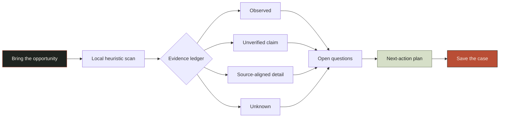

<div align="center">

# NISHTHA

### Evidence before trust.

**A cinematic, evidence-first workspace for investigating opportunities before you commit.**

<br />

[](.nvmrc)
[](package.json)
[](src/components/InvestigationScene.jsx)
[](tests/)

<br />

> **Nishtha** means steadfastness — the discipline to stay with the evidence a little longer.

</div>

<br />

## The one-line pitch

Most opportunity tools rush toward a verdict. **Nishtha slows the moment down.** It takes an invitation, fellowship, grant, job listing, or offer and turns it into a readable trail of:

```text
what was actually said  →  what the text supports  →  what remains unknown  →  what to ask next
```

This is not a generic AI dashboard. It is an editorial research room with a real-time 3D evidence desk, a friendly guide named **Nishi**, explainable local heuristics, and a report that refuses to confuse a claim with proof.

<div align="center">

### Observe · Separate · Trace · Act

</div>

---

## Why this feels different

<table>
<tr>
<td width="25%" valign="top">

### 01
### Cinematic first contact

An art-directed landing page with a procedural Three.js evidence desk: document, lens, source markers, depth, lighting, and a small paper companion.

</td>
<td width="25%" valign="top">

### 02
### Input-responsive reports

The local scan reacts to the supplied text. A fee-heavy message and a grant listing produce different evidence, signals, questions, and coverage.

</td>
<td width="25%" valign="top">

### 03
### Provenance over performance

Every finding can open into the original quote, evidence state, what it can support, and what it absolutely cannot prove.

</td>
<td width="25%" valign="top">

### 04
### A useful next step

The report ends with a checkable action plan. Completing a question means “addressed”, never “verified”.

</td>
</tr>
</table>

---

## What the demo contains

### The landing experience

- Warm paper / ink / muted olive / signal rust visual system.
- Sticky editorial navigation with a visible Cases archive.
- Reveal-on-scroll motion, tactile hover states, and mobile-first layout.
- A real WebGL scene built from procedural geometry — no paid assets, no video URL, no API key.
- A static layered fallback when WebGL is unavailable.

### The investigation workspace

- Three clearly labelled fictional sample opportunities:
  - **Fee request**
  - **Promising, incomplete**
  - **More specific, still open**
- Paste custom source text or start from a sample.
- Deterministic local heuristic scan for fee language, urgency, promises, contacts, organization details, and missing refund terms.
- Exact excerpts preserved as evidence quotes.

### The report room

- Explainable **Evidence coverage** breakdown.
- Expandable evidence ledger with `CAN SUPPORT` / `CANNOT SUPPORT` boundaries.
- Provenance view with source excerpts and local-source metadata.
- Next-action checklist with progress tracking.
- Save and reopen cases locally in the browser.

### Nishi, the guide

Nishi is a small paper-evidence companion, not a fake chatbot. Nishi offers contextual help for the current surface, supports keyboard interaction, remembers only small convenience preferences, and never decides whether an opportunity is legitimate.

---

## The product story in one flow



### Presenter-friendly 60-second demo

1. Start on the landing page and point to the line: **“Unknown is a valid status.”**
2. Click **Start investigation**.
3. Run **Fee request** and show that the report contains a quoted fee and a strong promise.
4. Switch to **More specific, still open** and run it again. The evidence and coverage visibly change.
5. Open an evidence row and show the exact quote plus its `CAN SUPPORT` and `CANNOT SUPPORT` boundary.
6. Explain the coverage breakdown: it measures available evidence, not legitimacy.
7. Check one next-action question, save the case, and reopen it from **Cases**.
8. Open Nishi and show contextual help without pretending there is a live AI behind it.

<details>
<summary><strong>What makes this a strong hackathon story?</strong></summary>

It is easy to understand in a minute, but hard to dismiss as a static mockup:

- The visual layer creates immediate memorability.
- The local analyzer proves that the experience responds to user input.
- The provenance view makes the evidence-first promise concrete.
- The checklist turns a report into a decision-support workflow.
- The boundaries are honest: no fabricated external verification, no fake confidence, no hidden API dependency.

</details>

---
## Trust contract

Nishtha is deliberately explicit about its limits:

| Nishtha can show | Nishtha does **not** claim |
| --- | --- |
| Exact phrases found in the supplied text | That an opportunity is legitimate or fraudulent |
| Visible fee, urgency, promise, contact, and organization signals | That a contact address belongs to the named organization |
| A transparent local coverage breakdown | That a numeric score is a risk probability |
| Questions worth asking next | That checking a question completes verification |
| What the source text can and cannot support | That an external website or database was checked |

> The local prototype is evidence organization, not an authority machine.

---

## Architecture

```text
src/
├── App.jsx                         # landing, workspace, report, cases, sources
├── main.jsx                        # React entry point
├── styles.css                      # shared editorial design system + responsive motion
├── lib/
│   ├── guide.js                    # contextual Nishi routing and copy
│   └── investigation.js             # deterministic input-responsive analyzer
└── components/
    ├── InvestigationScene.jsx      # lazy-loaded R3F / Three.js evidence desk
    ├── NishiGuide.jsx              # accessible contextual guide
    └── Reveal.jsx                   # IntersectionObserver reveal utility

tests/
├── guide.test.mjs                  # guide context and route mapping
└── investigation.test.mjs          # evidence extraction and uncertainty boundaries
```

### Technical choices

| Area | Choice | Why |
| --- | --- | --- |
| UI | React 18 + Vite | Fast local iteration and a small, portable frontend |
| 3D | React Three Fiber + Three.js + Drei | Real geometry, lighting, depth, and pointer response |
| Analysis | Pure JavaScript heuristics | Offline, deterministic, inspectable, no API key |
| Persistence | Browser `localStorage` | Useful saved-case demo without a backend dependency |
| Motion | CSS + `useFrame` + IntersectionObserver | Purposeful motion with reduced-motion support |
| Fallback | Static evidence-desk composition | The core experience remains usable without WebGL |

---

## Quick start

### Requirements

- Node.js `22.14.0` — pinned in [`.nvmrc`](.nvmrc)
- npm 10+

### Install

```bash
npm ci
```

### Start the app

```bash
npm run dev
```

Open **http://localhost:5173**.

### Build for production

```bash
npm run build
npm run preview
```

### Run the offline test suite

```bash
npm test
```

### Docker

```bash
docker build -t nishtha .
docker run --rm -p 4173:4173 nishtha
```

Then open **http://localhost:4173**.

---

## Project commands

| Command | Purpose |
| --- | --- |
| `npm run dev` | Start Vite development server |
| `npm test` | Run the offline Node test suite |
| `npm run build` | Create the production bundle |
| `npm run preview` | Serve the production bundle locally |
| `make test` | Buildathon-compatible test alias |
| `make build` | Buildathon-compatible build alias |

---

## Accessibility and performance

- Keyboard-visible focus states across buttons, links, tabs, dialogs, and checklists.
- Nishi supports Escape, focus return, minimize, reopen, and contextual navigation.
- `prefers-reduced-motion` disables nonessential scene and mascot movement.
- The 3D scene is dynamically imported so the landing shell becomes interactive before WebGL finishes loading.
- Device pixel ratio is capped for the scene.
- WebGL failure renders a meaningful still evidence desk instead of a blank canvas.
- No external fonts, paid models, hosted videos, or API keys are required for the core demo.

---

## Design language

```text
Warm paper      #F4F1E9
Ink             #202420
Muted olive     #69745A
Signal rust     #B94E35
Editorial type  Source Serif 4 / Georgia fallback
UI type         IBM Plex Sans / system fallback
Evidence type   IBM Plex Mono / system fallback
```

The interface uses physical depth selectively: the landing page can feel cinematic, while reports stay quiet, legible, and inspectable.

---

## Verification status

The current checked baseline includes:

```text
✓ npm ci --no-audit --no-fund
✓ npm test                 5 passing
✓ npm run build            passing
✓ npm run dev              HTTP 200 on localhost:5173
✓ WebGL fallback path      implemented
✓ reduced-motion path      implemented
```

The build may warn about the size of the lazy Three.js chunk. This is intentional code splitting: the heavy scene is loaded separately from the initial UI bundle.

---

## Roadmap after the hackathon

- Add opt-in external source connectors with explicit source provenance.
- Add encrypted server-side case sync only with a clear privacy model.
- Replace heuristics with a reviewed evidence extraction pipeline while keeping every quote traceable.
- Add real browser-level accessibility and responsive visual regression tests.
- Add exportable evidence reports for advisors, mentors, and support teams.

---

## License

This project is a hackathon prototype. Add the repository’s final license here before public distribution.

<div align="center">

### Make the next move carefully.

**Nishtha — evidence before trust.**

</div>
